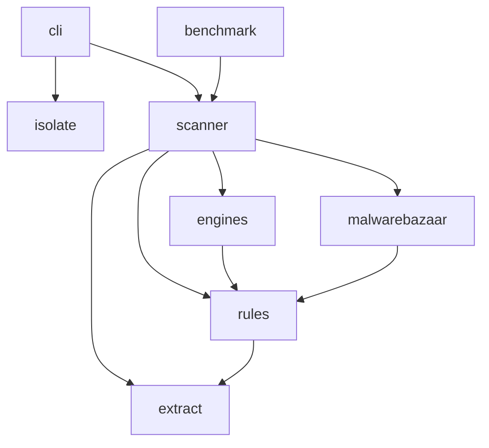
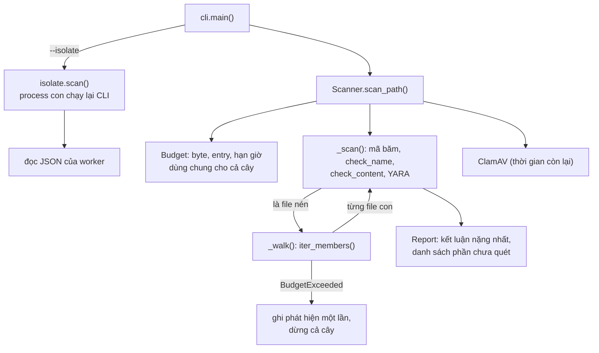

# Kiến trúc

Tài liệu cho người sửa code: mỗi module làm gì, dữ liệu đi qua đâu, và **muốn sửa X thì mở file nào**.

## Cấu trúc repo

```text
archive-guard/
├── archive_guard/          # mã nguồn (gói Python)
│   ├── cli.py              # dòng lệnh: đọc tham số, in báo cáo, ghi JSON, mã thoát
│   ├── isolate.py          # --isolate: chạy worker, hard timeout, giới hạn RAM, dọn cây process
│   ├── scanner.py          # điều phối: đệ quy file nén, gọi các lớp phát hiện, chấm điểm, rules_version
│   ├── extract.py          # giải nén streaming ZIP/TAR/GZ/7z/RAR + ngân sách tài nguyên (Budget)
│   ├── rules.py            # luật heuristic: tên file, loại file, packer, chỉ dấu hành vi, đọc mã băm
│   ├── engines.py          # YARA và ClamAV (tùy chọn)
│   ├── malwarebazaar.py    # tải mã băm theo họ từ MalwareBazaar
│   ├── benchmark.py        # đo precision/recall/tỷ lệ báo nhầm trên dữ liệu có nhãn
│   └── data/               # known_bad.txt, malwarebazaar.txt (cập nhật hằng tuần), rules/*.yar
├── tests/                  # mỗi file test một mảng (xem bảng cuối trang); helpers.py tạo mẫu thử
├── docs/                   # USAGE, ARCHITECTURE, RULES, BENCHMARK
├── benchmark/              # danh sách SHA-256 bộ dữ liệu sạch + kết quả đo thô (không chứa mẫu)
└── .github/                # CI, cập nhật mã băm, mẫu issue/PR, dependabot
```

## Phụ thuộc giữa các module

Phụ thuộc chỉ đi **một chiều**, từ trên xuống:



- `extract.py` không biết gì về luật hay chấm điểm: chỉ giải nén và giữ ngân sách.
- `rules.py` chỉ dùng `extract.archive_kind()` để nhận diện file nén lồng nhau.
- `isolate.py` không import module nào của dự án: nó chạy lại chính CLI trong một process con.

## Luồng một lần quét



1. `cli.main()` duyệt đường dẫn (thư mục → mọi file có chữ ký file nén) và tạo **một** `Scanner`.
2. `Scanner.scan_path()` tạo một `Budget` cho file đó rồi gọi `_scan()`.
3. `_scan()` chạy các lớp phát hiện trên nội dung. Nếu là file nén thì `_walk()` duyệt file con và **gọi lại
   `_scan()`** cho từng file, nhờ vậy file nén lồng nhau không cần code riêng.
4. Mọi phần không kiểm tra được được ghi vào `Report.incomplete`, và kết luận khi đó **không bao giờ là SẠCH**.

## Ngân sách tài nguyên (`extract.Budget`)

Một đối tượng `Budget` cho mỗi file nén gốc, truyền thẳng xuống bộ giải nén:

- `entry()`: gọi cho **mọi** entry khi duyệt danh mục, kể cả thư mục.
- `take(n)`: gọi sau **mỗi khúc 1 MB** giải nén ra; kiểm tra cả byte lẫn hạn thời gian.
- `check_entries(n)`: kiểm tra số entry **khai báo** trước khi nạp metadata (ZIP đọc từ bản ghi EOCD/ZIP64).
- Vượt ngưỡng → ném `BudgetExceeded`, kế thừa **`BaseException`** để không khối `except Exception` nào vô tình
  nuốt mất; `Scanner._walk()` bắt nó, ghi phát hiện đúng một lần (`_stop()`), rồi dừng cả cây.

Mỗi định dạng có một hàm đọc riêng trong `extract.py` (`_zip`, `_tar`, `_7z`, `_rar`) cùng trả về các `Member`.
Thêm định dạng mới = thêm một hàm như vậy, đăng ký trong `iter_members()` và trong `MAGIC` (chữ ký file).

## Kết luận

- `rules.Finding`: một phát hiện (mã luật, mức độ, nhóm, mô tả, bằng chứng, engine).
- `scanner.FileResult`: một file với các phát hiện; `verdict` tính từ điểm, thành `incomplete` nếu file có ghi chú
  "chưa quét".
- `scanner.Report`: một file nén gốc; kết luận nặng nhất theo thứ tự `clean < incomplete < suspicious < malicious`.
- `scanner.rules_fingerprint()`: sinh `rules_version` từ nội dung `rules.py` + `scanner.py`, luật YARA đã nạp và
  danh sách mã băm.

## `--isolate`

`isolate.scan()` chạy `python -m archive_guard <file> --_worker --json <tạm>` trong một process con với thư mục
tạm rỗng làm `cwd`, mật khẩu qua stdin; `isolate.run()` canh hard timeout và luôn dọn **cả cây** process
(Linux/macOS: process group; Windows: Job Object). Worker treo/crash/JSON hỏng → báo cáo `incomplete` với
`worker_error`. Giới hạn RAM: `RLIMIT_AS` (Linux), Job Object (Windows).

## Muốn sửa X thì sửa ở đâu

| Muốn | Sửa | Test ở |
|---|---|---|
| Thêm/chỉnh chỉ dấu hành vi | `_INDICATORS` trong `rules.py` (xem [RULES.md](RULES.md)) | `tests/test_detection.py` |
| Thêm luật tên file, packer | `check_name()`, `check_packer()` trong `rules.py` | `tests/test_detection.py` |
| Đổi ngưỡng điểm, cách tính kết luận | `score_and_verdict()`, `VERDICTS` trong `scanner.py` | `tests/test_detection.py`, `tests/test_cli.py` |
| Thêm định dạng nén | `extract.py`: hàm đọc mới + `iter_members()` + `MAGIC` | `tests/test_archives.py`, `tests/test_budget.py` |
| Báo định dạng chứa file chưa hỗ trợ | `UNSUPPORTED` trong `extract.py` | `tests/test_archives.py` |
| Đổi giới hạn tài nguyên mặc định | tham số `Scanner.__init__` + tùy chọn trong `cli.py` | `tests/test_budget.py` |
| Thêm engine mới (vd. VirusTotal) | `engines.py`, gọi từ `Scanner._scan()` hoặc `scan_path()` | `tests/test_budget.py` (timeout) |
| Thêm tùy chọn dòng lệnh | `cli.py` (nhớ chuyển tiếp cho worker trong `worker_args`) | `tests/test_cli.py` |
| Thêm trường JSON | `to_dict()` trong `scanner.py` hoặc `cli.py`; **chỉ thêm**, không đổi/xóa | `tests/test_cli.py` (`SCHEMA_V1`) |
| Đổi họ mã độc tải từ MalwareBazaar | `FAMILIES` trong `malwarebazaar.py` | `tests/test_hashes.py` |
| Thêm luật YARA đi kèm | `archive_guard/data/rules/*.yar` | `tests/test_detection.py` |
| Hành vi worker / hard timeout | `isolate.py` | `tests/test_isolate.py` |
| Chỉ số benchmark | `benchmark.py` | `tests/test_benchmark.py` |

## Test

| File | Kiểm tra |
|---|---|
| `tests/helpers.py` | Tạo mẫu thử trong bộ nhớ (`make_zip`, `make_7z`, `make_pe`, `tar_gz`, EICAR…); repo không chứa mã độc thật |
| `tests/test_detection.py` | Luật phát hiện, packer, YARA, hồi quy cho các lỗi luật đã sửa |
| `tests/test_archives.py` | Định dạng nén, mật khẩu, định dạng chưa hỗ trợ, `CHƯA QUÉT ĐỦ` |
| `tests/test_budget.py` | Chống archive bomb: ngân sách, streaming, giới hạn entry, timeout engine |
| `tests/test_cli.py` | Mã thoát, hợp đồng JSON `schema_version` 1, `rules_version` |
| `tests/test_isolate.py` | Worker treo/crash/hết RAM, kill cả cây process |
| `tests/test_hashes.py` | Cập nhật mã băm (API giả lập) |
| `tests/test_benchmark.py` | Chỉ số precision/recall |
